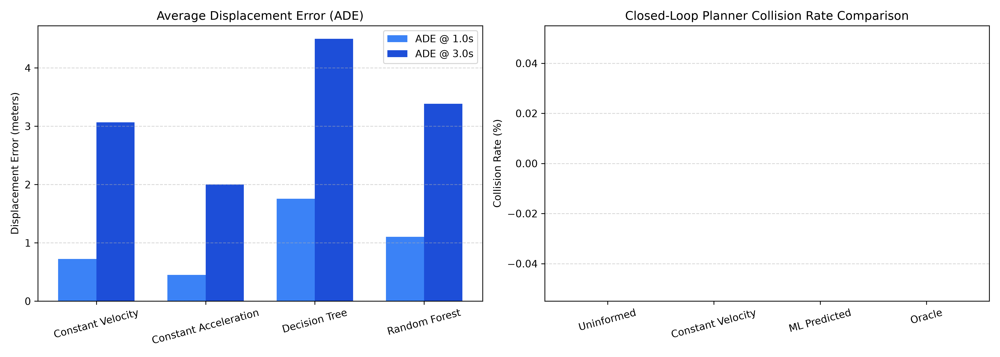

# Resultados Experimentais: Prever para Planear (Predict to Plan)

## 1. Benchmark de Modelos de Predição de Trajetória (ML)

| model_name                 |   ade_1s |   fde_1s |   ade_3s |   fde_3s |   ade_5s |   fde_5s |   mean_inference_time_ms |
|:---------------------------|---------:|---------:|---------:|---------:|---------:|---------:|-------------------------:|
| Constant Velocity (CV)     |    0.725 |    0.725 |    3.065 |    5.404 |    6.357 |   12.941 |                   0      |
| Constant Acceleration (CA) |    0.45  |    0.45  |    2.002 |    3.554 |    5.002 |   11.003 |                   0.0001 |
| Decision Tree (depth=6)    |    1.756 |    1.756 |    4.499 |    7.242 |    8.224 |   15.673 |                   0.0002 |
| Random Forest (trees=60)   |    1.104 |    1.104 |    3.384 |    5.664 |    6.643 |   13.161 |                   0.0119 |

## 2. Importância das Features (Random Forest)

|                     |          0 |
|:--------------------|-----------:|
| agent_vy            | 0.459843   |
| agent_vx            | 0.44872    |
| agent_speed         | 0.0355983  |
| past_dx_1s          | 0.0123765  |
| past_heading_change | 0.0105198  |
| past_dy_1s          | 0.00606302 |
| rel_vx              | 0.00550293 |
| past_speed_mean     | 0.00496622 |
| agent_heading       | 0.00484358 |
| ego_speed           | 0.0033624  |

## 3. Avaliação em Malha Fechada do Planeador A* com Evasão de Obstáculos

| Planning Modality            |   Scenarios Tested |   Collision Rate (%) |   Min Clearance (m) |   Emergency Decels / Run |   Avg Speed (m/s) |
|:-----------------------------|-------------------:|---------------------:|--------------------:|-------------------------:|------------------:|
| Uninformed (Reactive)        |                 25 |                    0 |               14.96 |                     0.08 |              4.89 |
| Constant Velocity            |                 25 |                    0 |               14.96 |                     0    |              4.91 |
| ML Predicted (Random Forest) |                 25 |                    0 |               14.96 |                     0    |              4.91 |
| Oracle (Ground Truth)        |                 25 |                    0 |               14.96 |                     0    |              4.91 |

